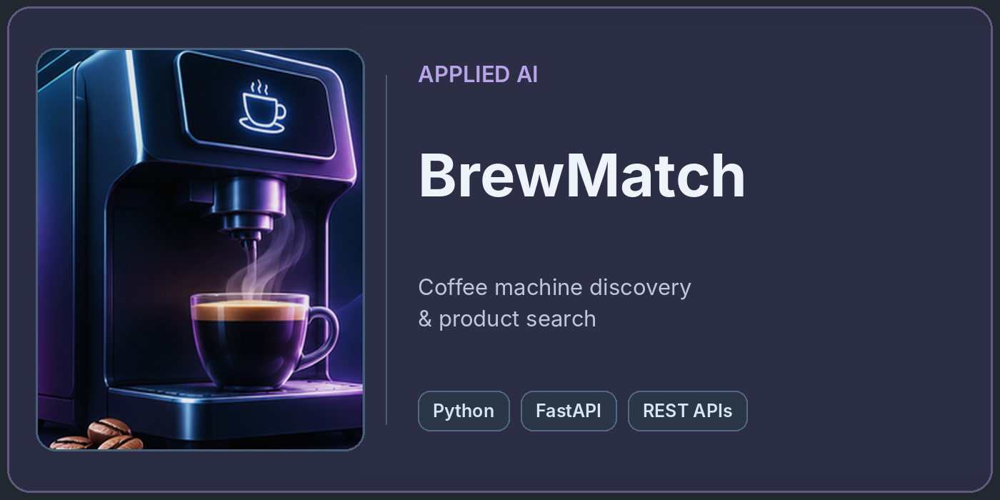
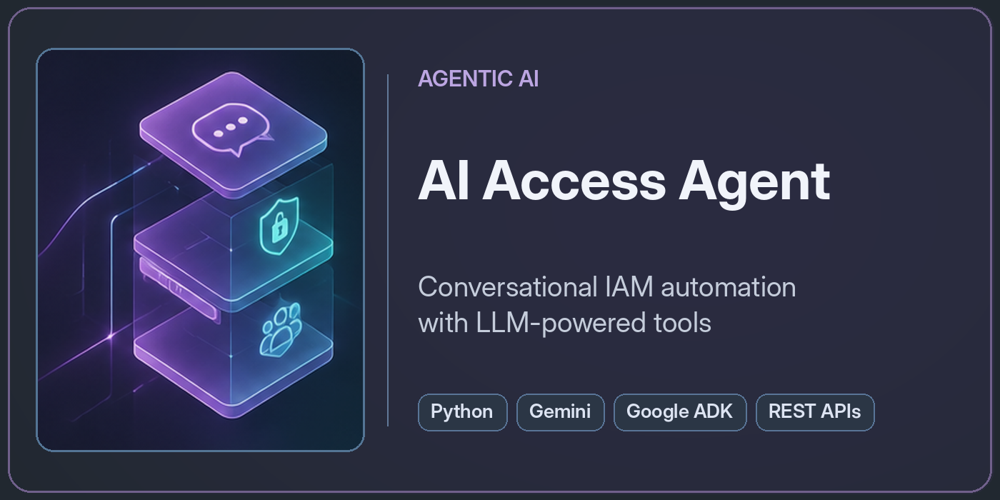
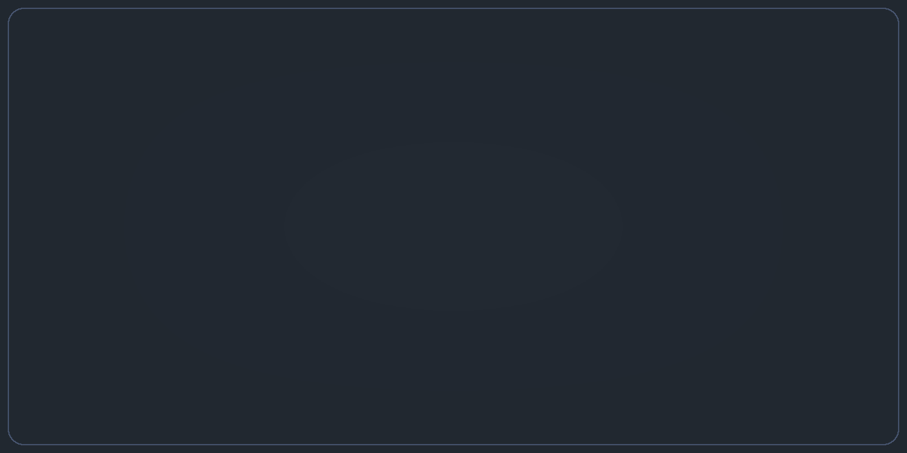

<!-- GitHub profile portfolio: Soft dark aligned to #212830 -->

 
<!-- Fourth project will be added here -->
<!-- Future projects: add two more linked 49.5%-width images here for the 2x2 layout. -->

