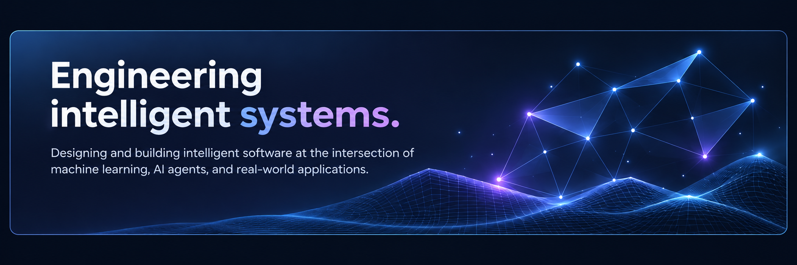
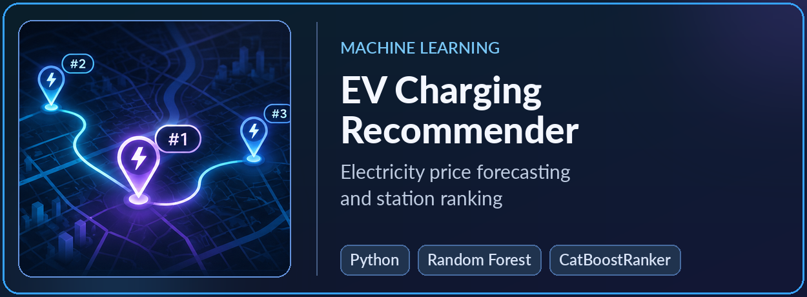
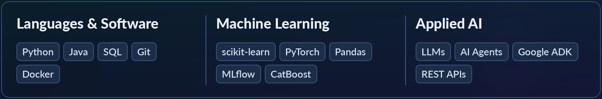

  

### About

Software Engineer focused on Applied AI and Machine Learning. I build intelligent software systems combining predictive modeling, backend engineering, and practical AI applications.

### Featured Projects

  
  

<!-- Two more project cards can be added below, using the same layout. -->

### Technology Stack

  

