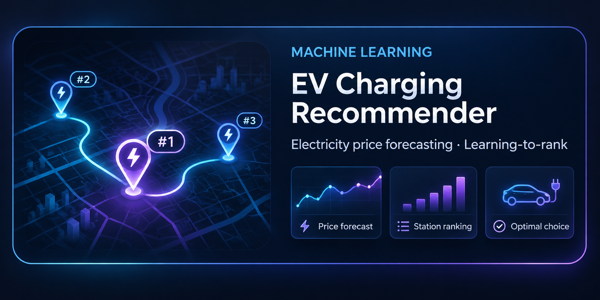
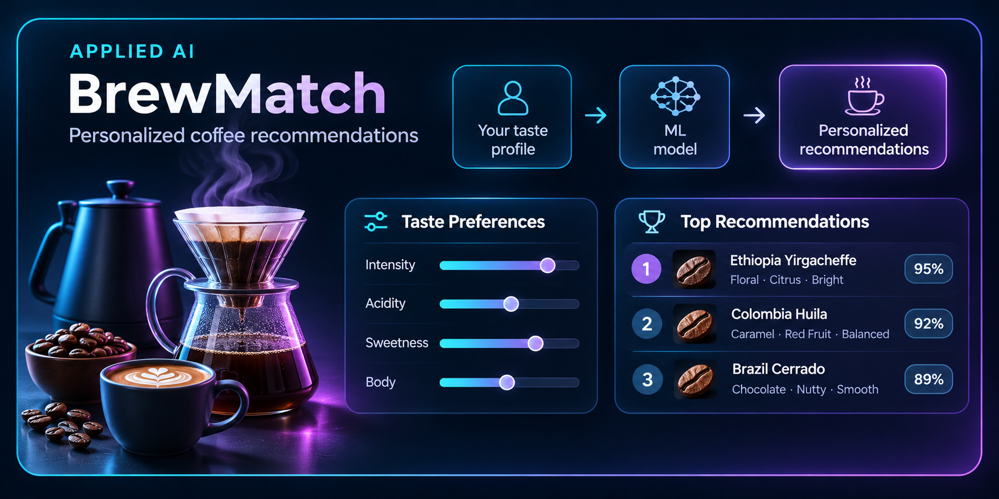

<!-- HERO -->

  

<!-- ABOUT -->
<h2>About</h2>

  Software Engineer focused on Applied AI and Machine Learning.
  I build intelligent software systems, combining predictive
  modeling, backend engineering, and AI-driven applications.

 

<!-- FEATURED PROJECTS -->
<h2>Featured Projects</h2>

<table>
<tr>

<td width="50%" valign="top">
  

  <h3>EV Charging Recommender</h3>

  

    Intelligent EV charging recommendations combining
    electricity price forecasting and learning-to-rank.
  

  

    <code>Python</code>
    <code>Random Forest</code>
    <code>CatBoostRanker</code>
  

</td>

<td width="50%" valign="top">
  

  <h3>BrewMatch</h3>

  

    Coffee machine discovery application featuring
    product search and a FastAPI backend.
  

  

    <code>Python</code>
    <code>FastAPI</code>
    <code>REST APIs</code>
  

</td>

</tr>
</table>

 

<!-- TECHNOLOGY STACK -->
<h2>Technology Stack</h2>

<table>
<tr>
<td width="33%" valign="top">

<strong>Languages & Software</strong>

  <code>Python</code>
  <code>Java</code>
  <code>SQL</code>
  <code>Git</code>
  <code>Docker</code>

</td>
<td width="34%" valign="top">

<strong>Machine Learning</strong>

  <code>scikit-learn</code>
  <code>PyTorch</code>
  <code>Pandas</code>
  <code>MLflow</code>
  <code>CatBoost</code>

</td>
<td width="33%" valign="top">

<strong>Applied AI</strong>

  <code>LLMs</code>
  <code>AI Agents</code>
  <code>Google ADK</code>
  <code>REST APIs</code>

</td>
</tr>
</table>
